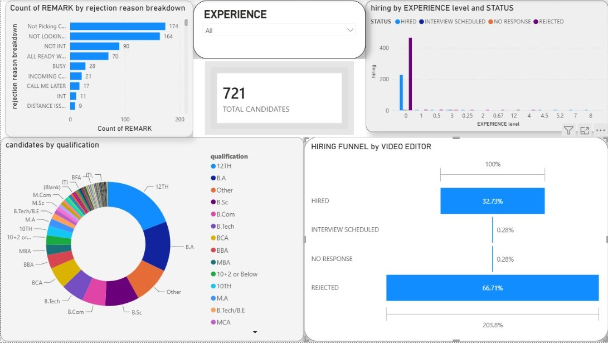

# Hiring Dashboard - Power BI

Power BI Hiring Dashboard - 721 candidates analysis

## Key Insights
- **Total Candidates:** 721
- **Hired:** 32.73% (236)
- **Rejected:** 66.71% (481)
- **Top Rejection Reason:** Not Picking Call
- **Top Education:** 12th & B.A candidates sabse jyada the
- **Top Cities:** Kanpur, Lucknow, Unnao

## Files in this Repo
- `HIRING PROJECT.pbix` - Power BI Source File
- `HIRING PROJECT.pdf` - PDF Report
- `dashboard-preview.jpeg` - Dashboard Screenshot

## Tools Used
Power BI, Excel
